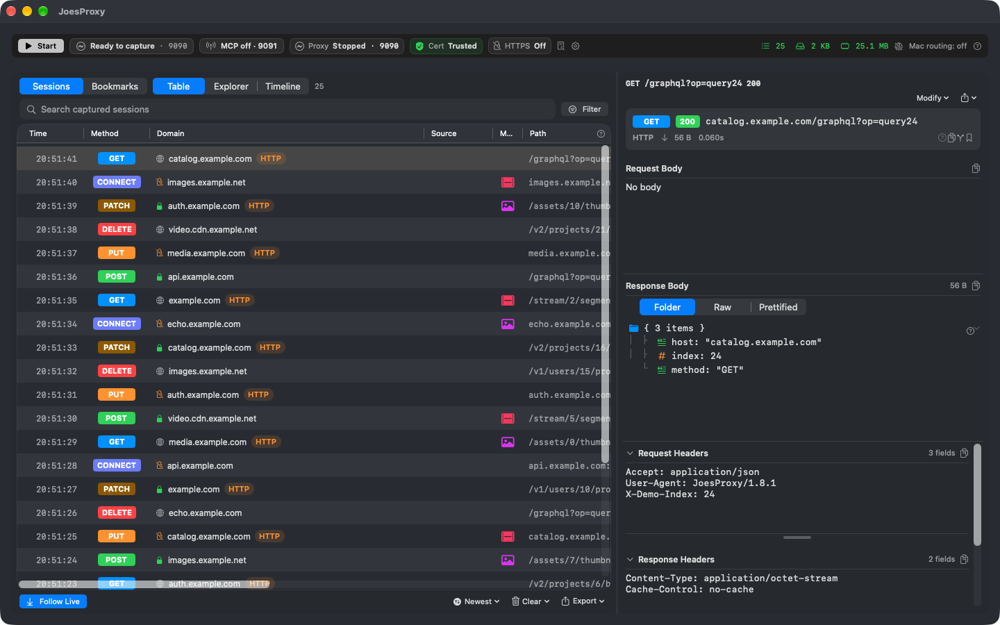

# JoesProxy

JoesProxy is a free, open-source network debugging proxy for macOS, released under the [MIT License](LICENSE). Inspect the request your app made, change the response it gets, and compare the next run. A coding agent can work with the same capture through MCP; you control what it can read and which changes it can apply.

## Build from source

Start with the [five-minute HTTP walkthrough](docs/GETTING-STARTED.md). It covers dependencies, local signing, and a first request to a loopback server. You do not need to install a certificate to try plain HTTP.

The app targets macOS 15.1 or later. The last tested toolchain was Xcode 27.0. Optional local model features require macOS 26 and an available system model.

## What to try next

- **Inspect a refresh.** Repeat an action in your app, find its request in the timeline, and inspect the status, timing, and any retained response body.
- **Test a different response.** Map an endpoint to a local file or prepare a JSON rewrite. Repeat the request and check both the captured response and what the app displays.
- **Investigate playback.** Serve a synthetic HLS stream and inspect the playlist and segments your player requests. Verify playback in the player itself.
- **Ask your agent a bounded question.** For example, total the prices in a captured JSON cart on your Mac. Even when only the sum comes back, the agent needs permission to read the source body.

The [documentation index](docs/index.md) links to setup, privacy, and the bundled command reference. See [validation notes](docs/VALIDATION.md) for what was tested and what remains unverified.

## Project information

Created by Joseph McCraw. AI tools were used in development. External code contributions and unsolicited pull requests are currently closed; see the [participation policy](CONTRIBUTING.md).

[Changelog](CHANGELOG.md) · [Security reporting](SECURITY.md) · [License](LICENSE) · [Acknowledgments](ACKNOWLEDGMENTS.md)
