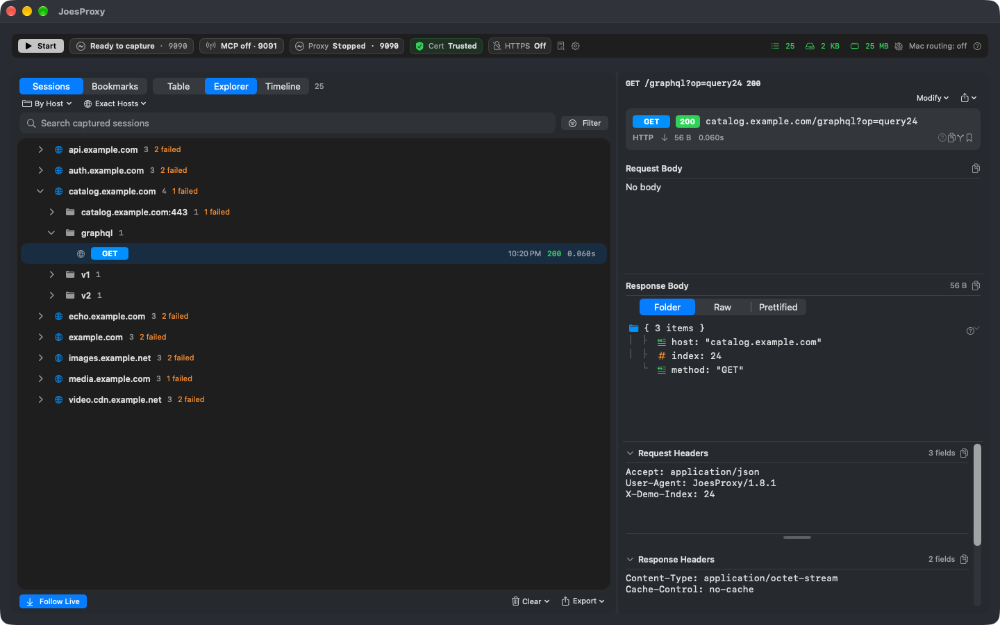
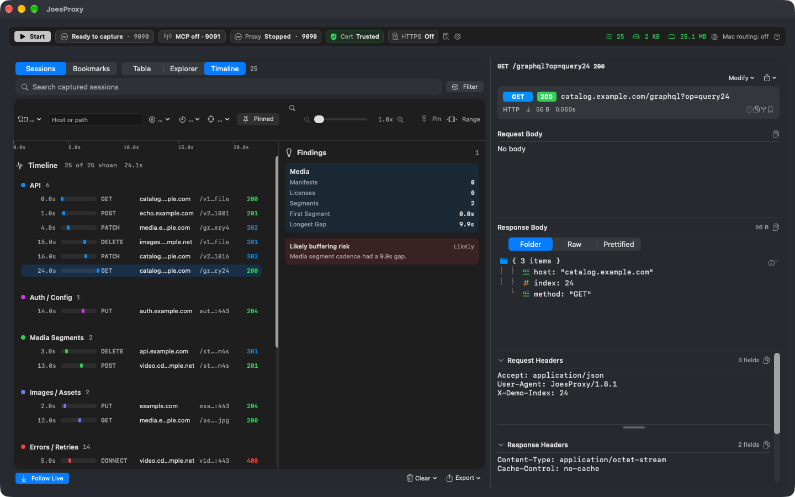
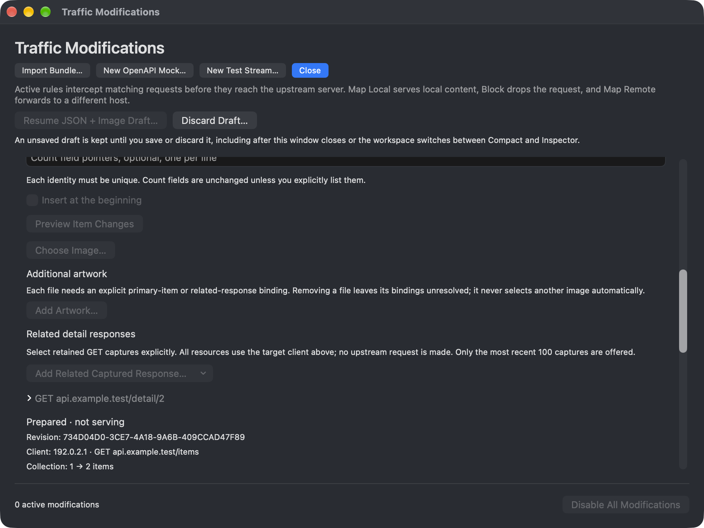
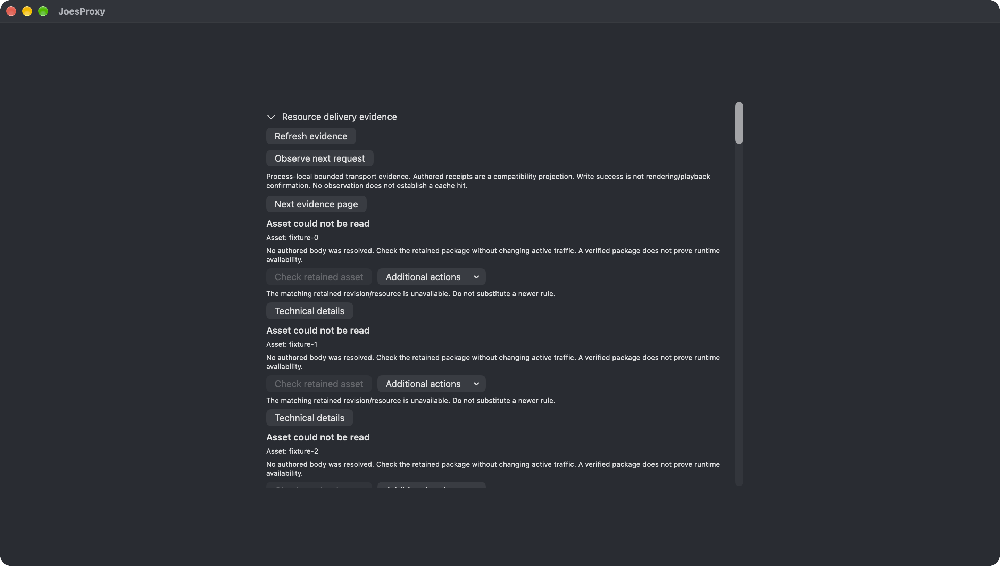
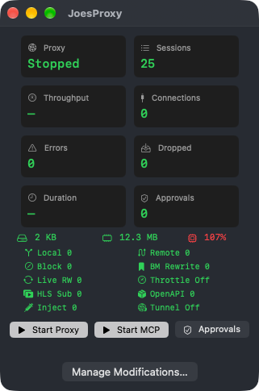

# JoesProxy

JoesProxy is a free, open-source network debugging proxy for macOS, released under the [MIT License](LICENSE). Inspect the request your app made, change the response it gets, and compare the next run. A coding agent can work with the same capture through MCP; you control what it can read and which changes it can apply.

Explore the guides and documentation at [joesproxy.com](https://joesproxy.com/).

## Feature tour

**Follow a request.** Capture an app refresh, group the requests by host and endpoint in Explorer, then switch to Timeline to see their order. Select a request to inspect its status, headers, timing, and available body. For a repeatable API test, prepare a local response or a field-level JSON rewrite, review its scope, then repeat the refresh.

**Save the evidence.** Reopen a `.jproxy` recording offline to investigate the same requests later. Full Recording preserves the bodies still available at save time. Metadata Only keeps timing, headers, and status. Text Bodies Only keeps readable payloads such as JSON and playlists. Media Focused keeps manifests, initialization segments, streaming metadata, and bounded media bodies. Choose the mode before sharing and review headers as well as payloads for sensitive data.

**Serve a repeatable HLS stream.** Point a test player at the fixture server to request a known playlist and its segments. Use a video-on-demand fixture for a fixed sequence or a supported looping live fixture for a sliding playlist. Repeat the same player action and compare which resources it requests on each run.

**Investigate streaming delivery.** Inspect an HLS master playlist for variants, bandwidths, resolutions, and alternate renditions. In a media playlist, inspect target duration, segments, and discontinuities. For DASH, inspect manifest structure and segment templates. Compare what the manifest advertises with the requests, statuses, and timing in the capture. A missing segment request and a segment request that returned an error lead to different investigations. Check playback in the player itself.

**Keep agent reads small.** An MCP client can start with `capture_digest`, reuse a state token to check for changes, then ask `sessions_search` for matching requests after its last sequence number. Page limits, minimal projections, and response-byte budgets bound how much goes into the agent’s context. Request a detailed summary only for the session that matters. Reading a body requires separate approval.

## Screenshot gallery

These examples use synthetic traffic. The workspace above shows the structured JSON inspector with capture stopped.

### Explorer

Drill from a host into an endpoint to find the individual request you want to inspect.

### Timeline

### Mock authoring

### Evidence

### Compact monitoring

## Build from source

Start with the [five-minute HTTP walkthrough](docs/GETTING-STARTED.md). It covers dependencies, local signing, and a first request to a loopback server. You do not need to install a certificate to try plain HTTP.

The app targets macOS 15.1 or later. The last tested toolchain was Xcode 27.0. Optional local model features require macOS 26 and an available system model.

## What to try next

- **Inspect a refresh.** Repeat an action in your app, find its request in the timeline, and inspect the status, timing, and any retained response body.
- **Test a different response.** Map an endpoint to a local file or prepare a JSON rewrite. Repeat the request and check both the captured response and what the app displays.
- **Investigate playback.** Serve a synthetic HLS stream and inspect the playlist and segments your player requests. Verify playback in the player itself.
- **Ask your agent a bounded question.** For example, total the prices in a captured JSON cart on your Mac. Even when only the sum comes back, the agent needs permission to read the source body.

The [documentation index](docs/index.md) links to setup, privacy, and the bundled command reference. See [validation notes](docs/VALIDATION.md) for what was tested and what remains unverified.

## Project information

Created by Joseph McCraw. AI tools were used in development. External code contributions and unsolicited pull requests are currently closed; see the [participation policy](CONTRIBUTING.md).

[Changelog](CHANGELOG.md) · [Security reporting](SECURITY.md) · [License](LICENSE) · [Acknowledgments](ACKNOWLEDGMENTS.md)
